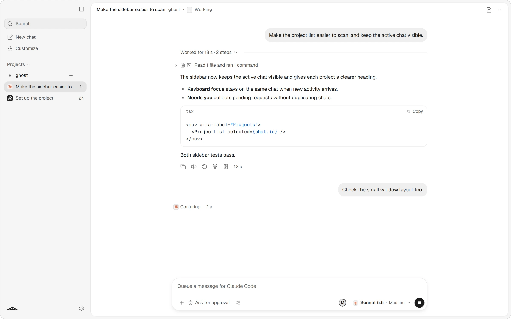
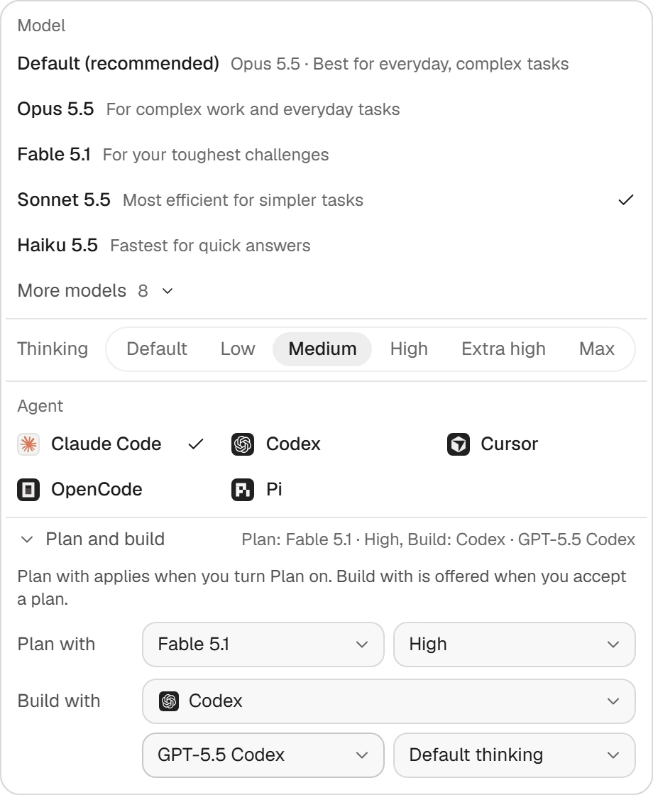
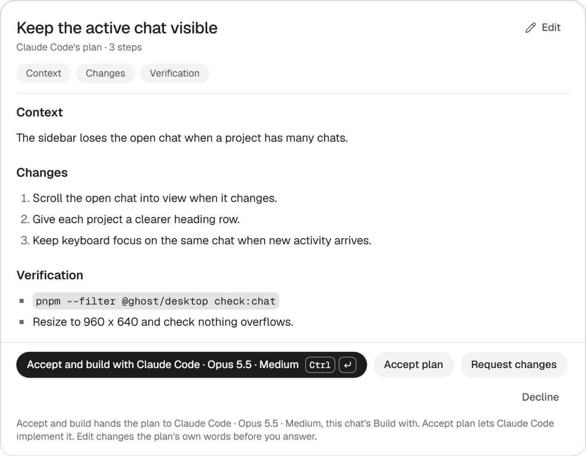

<p align="center">
  <picture>
    <source media="(prefers-color-scheme: dark)" srcset=".github/assets/readme/wing-dark.svg">
    
  </picture>
</p>

<h1 align="center">Ghost ADE</h1>

<p align="center">
  <b>One home for every coding agent you use.</b><br>
  Claude Code, Codex, Cursor, Grok Build and more, side by side in one fast desktop app.<br>
  Local first, open source, no account.
</p>

<p align="center">
  <a href="https://onghost.dev/download"><b>Download</b></a>
  &nbsp;&middot;&nbsp;
  <a href="https://onghost.dev">Website</a>
  &nbsp;&middot;&nbsp;
  <a href="CHANGELOG.md">Changelog</a>
  &nbsp;&middot;&nbsp;
  <a href="docs/development.md">Build from source</a>
</p>

<br>

<p align="center">
  <picture>
    <source media="(prefers-color-scheme: dark)" srcset=".github/assets/readme/hero-dark.webp">
    
  </picture>
</p>

## Your agents, in one window

Ghost runs the coding agents already on your computer through their own harnesses, with your own
sign-ins and subscriptions: **Claude Code, Codex, Cursor, Grok Build, OpenCode, Pi, Antigravity,
Hermes**, and any agent that speaks ACP. It finds them on its own, with their versions, sign-in
state and updates.

- **Projects and chats.** Every chat lives in a project. Run as many as you like at once, each in
  its own Git worktree if you want, and see which one needs you.
- **Switch mid-chat.** Change the agent, the model or the thinking level in the middle of a
  conversation. The conversation comes with it.
- **Watch it work.** Reasoning streams in as the agent thinks, calls group into readable steps, and
  every file it touched opens in Changes, line by line. Rewind a chat to any earlier message.
- **A browser beside the chat.** Agents can open, read and click pages while you watch, and you can
  point at the part of a page you want changed.
- **Instructions, memory and MCP, once.** Write instructions and project notes once, add MCP
  servers and plugins in one place, and every agent gets them.
- **Coordinated projects.** An experiment: a coordinator plans the work, hands it to worker chats
  and reports back, with a task board, a decision log and routines.
- **From your phone.** Follow and steer your chats from your phone's browser, or from an
  assistant like Grok through MCP.
- **A terminal, dictation and themes**, and it updates itself.

## Plan with one model, build with another

Each chat can name the model it plans with and the agent it builds with. Turn Plan on and the chat
moves to its planning model; accept the plan and it goes to the builder, in the same chat or to
another agent with the plan carried over.

<p align="center">
  <picture>
    <source media="(prefers-color-scheme: dark)" srcset=".github/assets/readme/menu-dark.webp">
    
  </picture>
  &nbsp;
  <picture>
    <source media="(prefers-color-scheme: dark)" srcset=".github/assets/readme/plan-dark.webp">
    
  </picture>
</p>

## Private by design

- **No Ghost account and no sign-in.** Your projects, chats and settings stay on your computer and
  never sync anywhere.
- **Nothing is uploaded.** Ghost goes online only to look up new versions of itself and of your
  agents, to install what you ask it to, and for remote access when you turn it on. Your agents
  talk to their own providers, as they always do.
- **Remote access is sealed end to end** for your phone: the relay passes along messages it cannot
  read, and your computer opens no port. A bot you link talks to the relay over HTTPS instead; its
  links are scoped, and you can remove them at any time.
- **Every update is signed** and checked before it installs.

## Install

| Platform | Download |
|---|---|
| Windows (x64 and ARM64) | `.exe` installer |
| macOS (Apple silicon and Intel) | `.dmg` |
| Linux (x64) | `.AppImage`, `.deb`, `.rpm` |

Get the latest from **[onghost.dev/download](https://onghost.dev/download)** or the
[Releases](https://github.com/itscool2b/ghost/releases/latest) page, each with its SHA-256 checksum.
The installers are not signed by a publisher yet, so Windows and macOS ask before the first run;
the download page says what to do. After that, Ghost updates itself.

## Build from source

You need Rust (stable), Node.js 22.12 or newer, pnpm 12 and
[Tauri's system dependencies](https://v2.tauri.app/start/prerequisites/). Then:

```sh
pnpm install
pnpm dev
```

A development build keeps its own data folder and runs beside an installed Ghost, so it never touches
your chats. **[docs/development.md](docs/development.md)** covers the layout, the checks, the
command-line client and every switch.

Ghost is Rust and TypeScript: a Rust core and a [Tauri](https://tauri.app) shell with a React
interface. The website and the relay behind remote access are Rust Workers on Cloudflare.

## Contributing

Issues and pull requests are welcome: [CONTRIBUTING.md](CONTRIBUTING.md) says how to send a change
and which checks to run first. To report a vulnerability, follow [SECURITY.md](SECURITY.md) and
please do not open a public issue.

## License

Ghost is released under the [MIT License](LICENSE). The software it includes keeps its own terms,
preserved in [third-party/](third-party/README.md) and shown in the app under Settings, About.
The names and logos of the agents Ghost drives belong to their owners.
